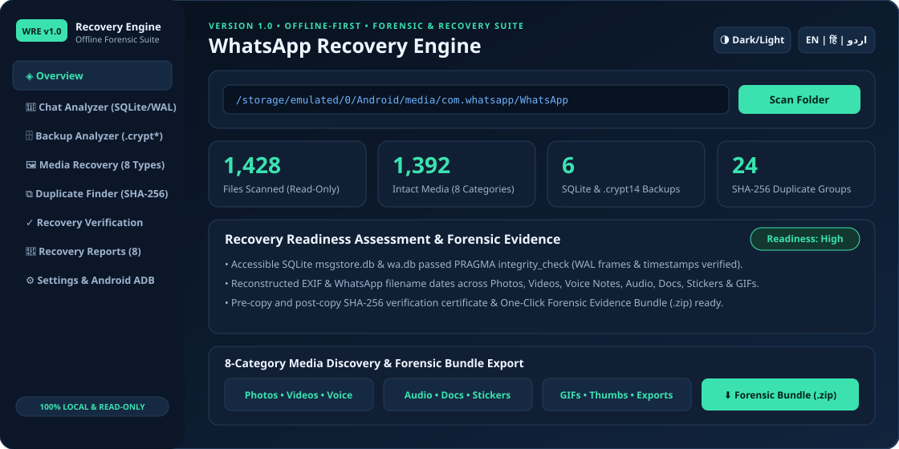

<div align="center">

# 🛡️ WhatsApp Recovery Engine — v1.0 (Advanced Edition)

**A Professional, Offline-First WhatsApp Backup Analysis, Chat Export Inspection, Media Discovery, Cryptographic SHA-256 Verification & Forensic Reporting Platform**

[](https://github.com/MrKhan025/whatsapp-recovery-engine)
[](https://www.python.org/)
[](https://fastapi.tiangolo.com/)
[](https://www.sqlite.org/)
[](https://github.com/MrKhan025/whatsapp-recovery-engine)
[](./SECURITY.md)

<br>



</div>

> **Forensic & Ethical Notice:** This project is an independent, read-only diagnostic and recovery-assistance platform for inspecting **files you own or are explicitly authorized to analyze**. It **never** bypasses WhatsApp encryption, **never** decrypts `.crypt12/.crypt14/.crypt15` files without a user-owned key/official restore flow, **never** bypasses OTPs, device locks, or Android Scoped Storage restrictions, and **never** claims guaranteed recovery of permanently deleted data.

## ✨ Key Capabilities & Roadmap Features Included in v1.0

| Module | Core Capabilities | Forensic Safety & Verification |
| :--- | :--- | :--- |
| **1. Advanced Chat Recovery Assistant** (`wtk/chat_analyzer.py`) | Detects `msgstore.db` & `wa.db`; inspects companion **SQLite Write-Ahead Log (`-wal`)** uncheckpointed frames; cross-references `message_media` attachments against disk (`link_chat_media`); parses **TXT, JSON & HTML** chat exports; compares two SQLite snapshots to locate missing (historical), modified, and new messages. | Opens databases strictly with `mode=ro&immutable=1` and `PRAGMA query_only = ON`; runs `PRAGMA integrity_check`. |
| **2. Advanced Media Recovery Engine** (`wtk/media_engine.py`) | Organizes accessible media into **8 categories**: Photos, Videos, Voice Notes, Audio, Documents, Stickers, GIFs & Thumbnails; **reconstructs original dates from EXIF `DateTimeOriginal` headers and WhatsApp filenames (`IMG-YYYYMMDD-WAxxxx`)** to detect OS timestamp drift; inline browser preview for images, videos & voice notes. | Validates magic-byte headers (`JPEG`, `PNG`, `GIF`, `WEBP`, `PDF`, `OggS`, `MP4`, `WAV`, `ZIP`) to flag corrupt or `0 B` files. |
| **3. Smart Backup Analyzer & User-Key Decryptor** (`wtk/backup_analyzer.py`, `wtk/decryptor.py`) | Discovers `.crypt12`, `.crypt14`, `.crypt15` & SQLite backups; inspects header structure; supports **strictly local AES-256-GCM + `zlib` decryption when the user supplies their own 32-byte hex key or 158-byte `key` file**; compares **2 or more** snapshots chronologically. | Never brute-forces or guesses keys; flags empty (`0 B`) or suspiciously small backups and produces a comprehensive **Backup Health Report**. |
| **4. Recovery Success Estimator** (`wtk/estimator.py`) | Evaluates accessible DBs, SQLite integrity, intact media, backup health, corruption indicators, duplicate redundancy & snapshot diffs. | Reports qualitative readiness (**Low / Medium / High**) with evidence, missing requirements & next steps (no fake `%` claims). |
| **5. Cryptographic Verification Engine** (`wtk/verification.py`) | Exports selected files to a separate destination outside the source directory and generates a signed **Recovery Verification Certificate**. | Computes **pre-copy and post-copy SHA-256 checksums**, prevents accidental overwrites, and blocks symlinks/traversal. |
| **6. Multi-Format Forensic Reporting & Bundle** (`wtk/reports.py`) | Generates **8 downloadable outputs**: PDF Report, JSON Scan Report, CSV Inventory, Backup Comparison, Media Recovery, DB Health, Verification Certificate & **One-Click Forensic Evidence Bundle (`.zip` with `SHA256SUMS.txt`)**. | Every report includes UTC timestamps, file counts, SHA-256 digests, anomaly warnings, and explicit technical limitations. |
| **7. Responsive 8-Tab Web Dashboard** (`web/`) | **Overview, Chat Analyzer, Backup Analyzer, Media Recovery, Duplicate Finder, Recovery Verification, Recovery Reports & Settings**. | Built-in **Dark & Light Themes** plus **English, Hindi (हिन्दी) & Urdu (اردو RTL)** multi-language support. |

## 🏗️ System Architecture

```text
whatsapp-recovery-engine/
├── wtk/                        # Core Python Package (v1.0.0)
│   ├── __init__.py             # Version & package metadata
│   ├── __main__.py             # `python -m wtk` entry point
│   ├── api.py                  # FastAPI REST backend & static dashboard mount
│   ├── cli.py                  # Command-Line Interface (scan, compare, inspect-db, serve, etc.)
│   ├── scanner.py              # Read-only directory tree scanner & inventory orchestrator
│   ├── chat_analyzer.py        # SQLite + WAL inspector, Chat-Media Linker, TXT/JSON/HTML parser & DB diff
│   ├── media_engine.py         # 8-category classifier, EXIF/filename date reconstruction & SHA-256 deduplicator
│   ├── backup_analyzer.py      # .crypt12/.crypt14/.crypt15 metadata analyzer & Backup Health Report
│   ├── decryptor.py            # Legitimate user-supplied 32-byte key AES-256-GCM decryptor
│   ├── estimator.py            # Qualitative Recovery Readiness Estimator (Low / Medium / High)
│   ├── verification.py         # Pre/post-copy SHA-256 verified export & Certificate generator
│   ├── reports.py              # 7 report formats + Forensic Evidence Bundle (.zip + SHA256SUMS.txt)
│   ├── adb.py                  # Authorized read-only ADB diagnostics & Android/Termux guidance
│   ├── security.py             # Path traversal guard, symlink chain validator & dependency auditor
│   ├── i18n.py                 # English, Hindi & Urdu (RTL) translations
│   └── sample_bootstrap.py     # Self-healing zero-PII synthetic sample dataset generator
├── web/                        # Responsive Single-Page Forensic Dashboard
│   ├── index.html              # 8-tab responsive UI with Dark/Light mode
│   ├── style.css               # Modern adaptive styling & RTL support
│   └── app.js                  # Interactive API client, filters, media player & report downloads
├── scripts/
│   └── termux-install.sh       # One-command Android Termux setup & launcher script
├── docs/
│   ├── screenshots/
│   │   └── dashboard-preview.svg
│   ├── RECOVERY-GUIDE.md       # Step-by-step user recovery workflow
│   └── SECURITY.md             # Operational security checklist
├── sample-data/                # Zero-PII Synthetic Test Snapshots (auto-initialized if missing)
│   ├── snapshot_v1/            # Earlier backup snapshot (SQLite msgstore.db, .crypt14, media)
│   └── snapshot_v2/            # Newer backup snapshot (8 media categories, exports, DB changes)
├── tests/                      # Automated Pytest Suite (19 comprehensive unit & integration tests)
│   ├── test_scanner.py         # Backup discovery, SQLite integrity, 8 categories, symlinks & traversal
│   ├── test_engine.py          # Snapshot comparison, multi-snapshot diff & verified export
│   └── test_api.py             # FastAPI endpoints, WAL, EXIF, user-key decryptor & Forensic Bundle
├── .github/
│   ├── workflows/ci.yml        # GitHub Actions CI (Pytest + Bandit Security Linter + pip-audit)
│   ├── dependabot.yml          # Weekly automated dependency security updates
│   ├── PULL_REQUEST_TEMPLATE.md
│   └── ISSUE_TEMPLATE/bug_report.md
├── Dockerfile                  # Non-root hardened container image
├── docker-compose.yml          # Loopback-bound (127.0.0.1:8000) read-only Compose service
├── pyproject.toml              # Package build configuration & pytest settings
├── requirements.txt            # Production dependencies
├── requirements-dev.txt        # Testing & security audit dependencies
├── requirements-termux.txt     # Termux-compatible dependencies
├── CONTRIBUTING.md             # Contributor & ethical compliance guidelines
├── CHANGELOG.md                # Release history (v1.0.0)
├── SECURITY.md                 # Security & privacy guarantees
└── LICENSE                     # MIT License
```

## 🚀 Step-by-Step Execution Guide

### Option 1: Run on Android via Termux (One-Line Installer or Manual Steps)

1. Install **Termux** on your Android device, clone the repository, and run the one-step installer:
   ```bash
   pkg update -y && pkg install -y git
   git clone https://github.com/MrKhan025/whatsapp-recovery-engine.git
   cd whatsapp-recovery-engine
   bash scripts/termux-install.sh
   ```
   *(Or run the manual steps: `pkg install -y python git libjpeg-turbo freetype`, `termux-setup-storage`, `pip install -r requirements-termux.txt`, and `python -m wtk serve --host 127.0.0.1 --port 8000`.)*

2. Open **`http://127.0.0.1:8000`** in Chrome/Firefox on your Android phone and scan your accessible WhatsApp shared folder:
   * **Android 11+ Path:** `/storage/emulated/0/Android/media/com.whatsapp/WhatsApp`
   * **Android 10 & Earlier Path:** `/storage/emulated/0/WhatsApp`

### Option 2: Run on Windows, Linux, or macOS (Step-by-Step)

```bash
# 1. Clone the repository
git clone https://github.com/MrKhan025/whatsapp-recovery-engine.git
cd whatsapp-recovery-engine

# 2. Create & activate a virtual environment
python3 -m venv .venv
source .venv/bin/activate   # Windows PowerShell: .venv\Scripts\Activate.ps1

# 3. Install dependencies
pip install --upgrade pip
pip install -r requirements.txt

# 4. Initialize synthetic sample datasets & start the dashboard
python -m wtk init-sample
python -m wtk serve --host 127.0.0.1 --port 8000
```
Open **`http://127.0.0.1:8000`** in your browser.

### Option 3: Command-Line Interface (CLI) Reference

```bash
# 1. Initialize synthetic sample datasets (snapshot_v1 and snapshot_v2)
python -m wtk init-sample

# 2. Scan an accessible folder and generate all reports + Forensic Bundle (.zip)
python -m wtk scan --source ./sample-data/snapshot_v2 --output ./reports

# 3. Compare two saved scan snapshots
python -m wtk compare ./reports/scan-*.json

# 4. Inspect an accessible SQLite chat database (and companion -wal file) in read-only mode
python -m wtk inspect-db ./sample-data/snapshot_v2/Databases/msgstore.db

# 5. Compare two accessible SQLite chat databases at the message record level
python -m wtk compare-db ./sample-data/snapshot_v1/Databases/msgstore.db ./sample-data/snapshot_v2/Databases/msgstore.db

# 6. Parse a user-provided TXT, JSON, or HTML chat export
python -m wtk parse-export ./sample-data/snapshot_v2/Exports/chat_export.json

# 7. Check ADB device status and Android storage guidance
python -m wtk adb-check

# 8. Run local security & dependency posture audit
python -m wtk security-audit
```

## 🧪 Running Automated Tests & Security Checks

```bash
pip install -r requirements-dev.txt
python -m wtk init-sample
python -m pytest -v
bandit -q -ll -r wtk
pip-audit -r requirements.txt
```
